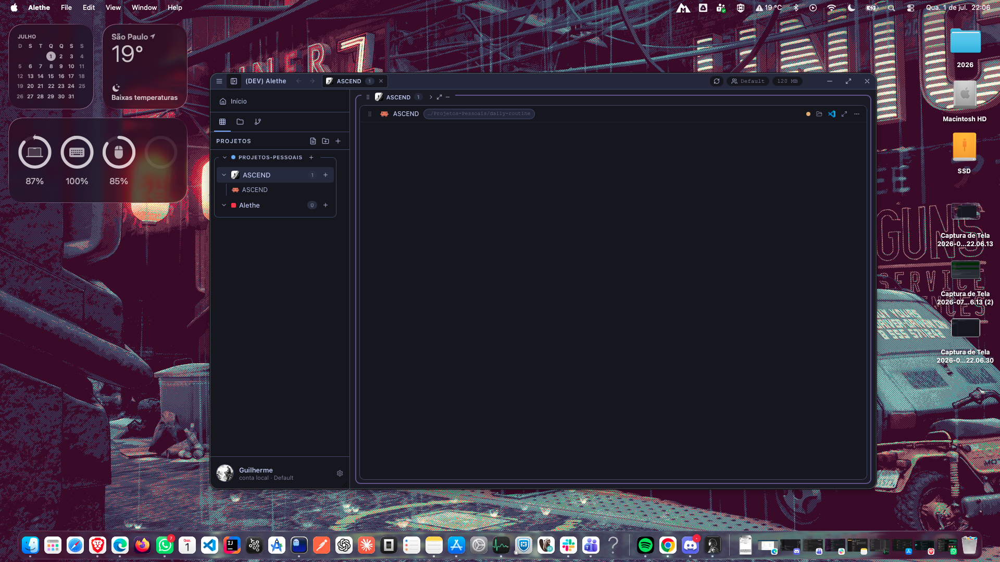
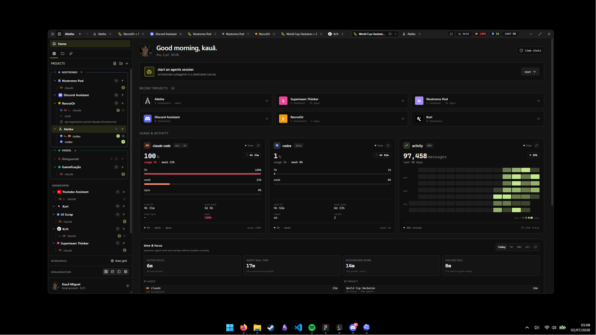
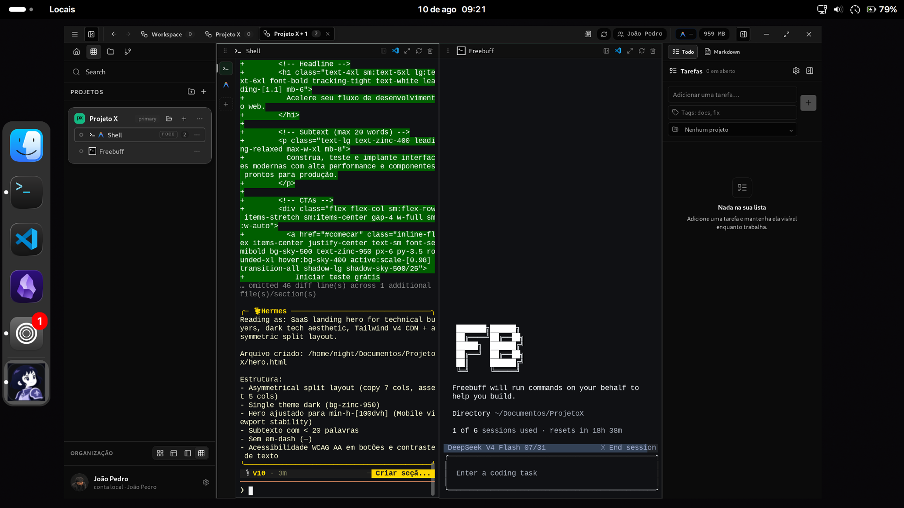
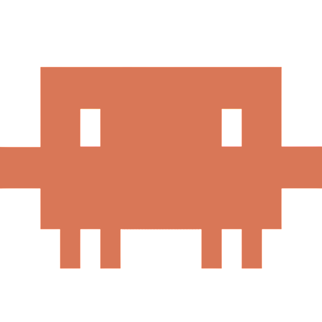
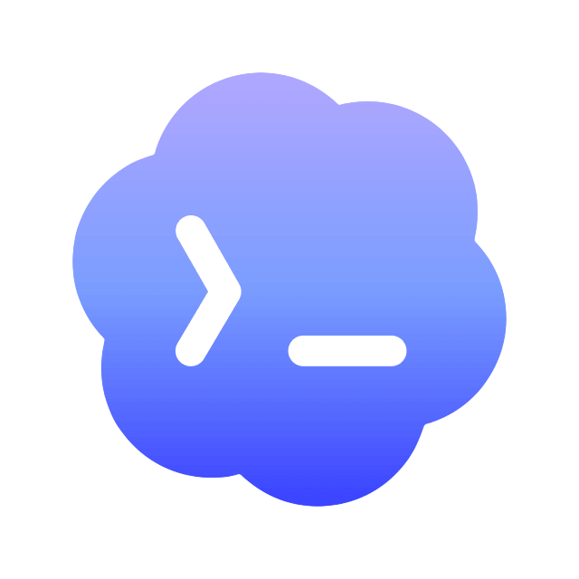
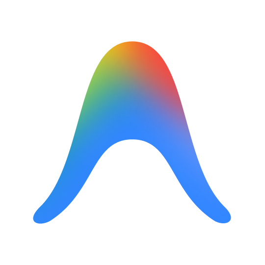
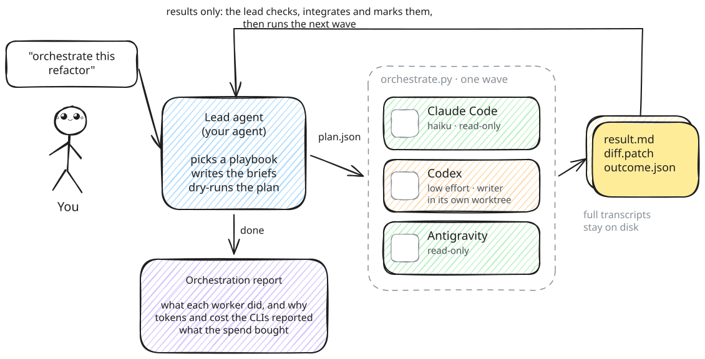
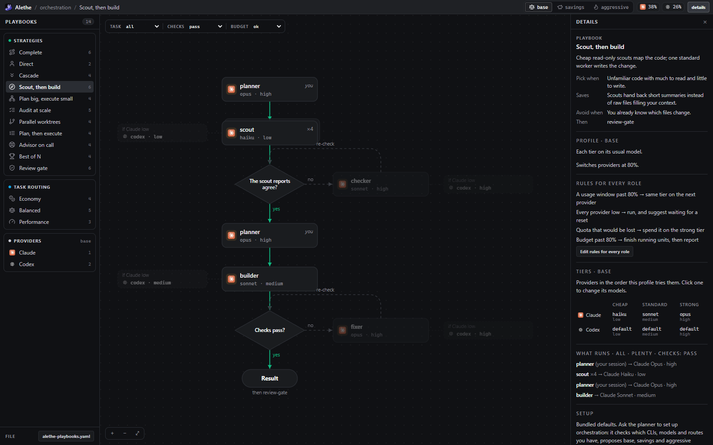
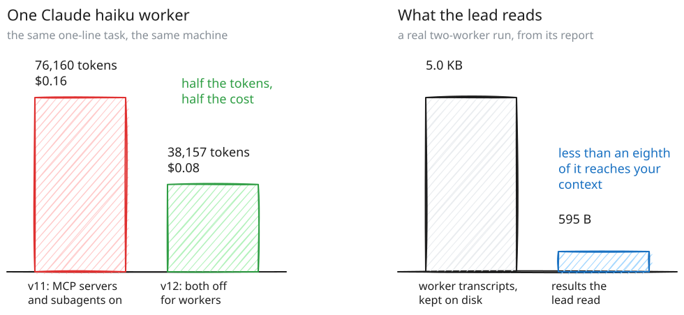

<a id="readme-top"></a>

<br />
<div align="center">
  <a href="https://github.com/Vnxcarvalho/Alethe-2.0">
    
  </a>

  <h1 align="center">Alethe</h1>

  <p align="center">
    <b>The multi-agent coding workspace.</b>
    <br />
    Run Claude Code, Codex, Copilot and your shells side by side — in one local-first desktop app.
    <br />
    <a href="./README.pt-BR.md">Português</a> · <a href="./README.zh-CN.md">中文说明</a>
  </p>

  <p align="center">
    <a href="https://github.com/Vnxcarvalho/Alethe-2.0/releases/latest"><b>Download Alethe</b></a>
    (Windows, macOS, Linux)
  </p>

  <p align="center">
    <a href="./docs/PRIVACY.md">Privacy</a>
    ·
    <a href="#contributing">Contribute</a>
  </p>
</div>

> [!IMPORTANT]
> Alethe is an early public release. The desktop app is free, open source, and local-first, not
> local-only: update checks and provider usage polling are on by default, while other network features
> are optional or action-triggered. Manual GitHub Gist Sync is already available; first-party hosted
> sync or cloud backup may be offered separately later. See the
> [privacy and data-flow guide](./docs/PRIVACY.md).

## What Alethe Is

One agent in one terminal is easy. Five agents across three repositories is the actual job — and
that is where terminal tabs stop working: sessions get lost, MCP servers drift out of sync between
agents, and nobody knows which agent is doing what, where.

**Alethe is a desktop workspace built for that.** Every agent runs in a real PTY inside a persistent
project layout, keeps its own session and history, and stays alive when you rearrange the UI. On top
of that, Alethe manages the things agents share: their CLIs, their MCP servers, their skills, and the
conversations you move between them.

Cross-platform (Windows, macOS, Linux), local-first, built with Tauri, Rust, React, and `xterm.js`.
“Local-first” describes workspace persistence, not an internet-free guarantee; see
[`docs/PRIVACY.md`](./docs/PRIVACY.md) for current network defaults, credentials, and retention.

## Latest Changes

Highlights from the unreleased work since 1.7.0. The full list lives in
[`docs/CHANGELOG.md`](./docs/CHANGELOG.md).

- **Agent teams.** Claude Code and Antigravity can open a lead plus one terminal per teammate, with
  a built-in `tmux` so nothing extra needs installing.
- **Plugins.** Plugin API 3 (follow every terminal tab), a plugin marketplace, plugins that open
  their own tab, and the new Agent Voice plugin.
- **Orchestration.** A Playbooks editor, strategy playbooks, setup that builds your profiles,
  orchestration reports, and limits enforced by the skill.
- **Sync.** Cloud sync that merges instead of overwriting, per-account and per-project MCP servers
  and skills, projects by computer, and settings export and import.
- **Voice.** Hands-free and continuous listening, an OpenRouter transcriber, and a compact voice pill.
- **Terminals.** Minimize instead of delete, close tabs with the middle mouse button, and
  administrator shell tabs.
- **Mobile.** Start agents and follow orchestration from your phone.
- **New app icon: Carvalho**, and Tutorials inside Preferences.

## Supported Platforms

<table>
  <tr>
    <th width="33.33%">macOS</th>
    <th width="33.33%">Windows</th>
    <th width="33.33%">Linux</th>
  </tr>
  <tr>
    <td align="center">
      
    </td>
    <td align="center">
      
    </td>
    <td align="center">
      
    </td>
  </tr>
  <tr>
    <td align="center">Available on macOS</td>
    <td align="center">Available on Windows</td>
    <td align="center">Available on Linux</td>
  </tr>
</table>

## Agents

| | Agent | CLI | |
|:-:|---|---|---|
|  | **Claude Code** | `claude` | Session resume, usage cards, local history |
|  | **Codex** | `codex` | Session resume, usage cards |
| <picture><source media="(prefers-color-scheme: dark)" srcset="./docs/assets/agents/copilot-dark.svg"></picture> | **GitHub Copilot CLI** | `copilot` | |
| <picture><source media="(prefers-color-scheme: dark)" srcset="./docs/assets/agents/cursor-dark.svg"></picture> | **Cursor** | `cursor-agent` | Session resume |
|  | **Antigravity** | `agy` | Usage cards |
| <picture><source media="(prefers-color-scheme: dark)" srcset="./docs/assets/agents/opencode-dark.png"></picture> | **OpenCode** | `opencode` | Session resume |
|  | **Kiro CLI** | `kiro-cli` | |
| <picture><source media="(prefers-color-scheme: dark)" srcset="./docs/assets/agents/kimi-dark.svg"></picture> | **Kimi Code** | `kimi` | |
| <picture><source media="(prefers-color-scheme: dark)" srcset="./docs/assets/agents/grok-dark.svg"></picture> | **Grok Build** | `grok` | |
| <picture><source media="(prefers-color-scheme: dark)" srcset="./docs/assets/agents/codewhale-dark.svg"></picture> | **Codewhale** | `codewhale` | |
| <picture><source media="(prefers-color-scheme: dark)" srcset="./docs/assets/agents/mimo-dark.svg"></picture> | **Mimo** | `mimo` | |
|  | **Freebuff** | `freebuff` | |
| <picture><source media="(prefers-color-scheme: dark)" srcset="./docs/assets/agents/shell-dark.svg"></picture> | **Shell** | pwsh / bash / zsh | The plain terminal, same pane model |
| <picture><source media="(prefers-color-scheme: dark)" srcset="./docs/assets/agents/wsl-dark.svg"></picture> | **WSL** | `wsl.exe` | The default distro, as a plain shell (Windows) |

Missing CLIs can be installed, updated, and uninstalled from inside Alethe — it probes the machine
for Node, npm, WinGet, Scoop, and Chocolatey and offers only the methods that actually work there,
preferring each vendor's official installer. Already-installed CLIs are discovered across PATH,
registry, npm/pnpm/Volta/fnm/nvm/Bun/Cargo/Scoop/Chocolatey, and can be pointed at a custom path.
A plugin can add an agent of its own to this list.

Agents can optionally be routed through [9router](https://github.com/decolua/9router), a local proxy
that spreads traffic across providers with automatic fallback. Alethe installs and runs a private,
version-pinned copy without touching your global npm packages. Routing is off by default and applies
only to terminals opened after it is switched on.

## What It Does

**Run agents in parallel**

- Projects, groups, and subgroups organize repositories; each open project becomes a container with
  its own panes.
- One agent per pane, or several agents as sub-tabs inside the same pane — each with its own PTY,
  working directory, and session.
- Auto, spotlight, sidebar, and custom grid layouts, editable directly on the grid.
- Closing a container hides it; the process keeps running.

**Keep the context**

- Sessions of Claude Code, Codex, Cursor, and OpenCode resume after a crash or a restart.
- **Recent chats** lists the conversations of a pane's working directory and reopens any of them.
- A Claude Code conversation can be **handed off to Codex** (and back) through a locally redacted
  context packet — no copy-pasting the thread by hand. Redaction is best effort, so review the packet
  before starting the target agent.
- Scrollback is persisted per PTY, so reattaching shows what happened before.

**Manage what the agents share**

- **MCP tab**: every MCP server configured on the machine, grouped by server and showing which agents
  have it — read from Claude Code, Codex, Cursor, OpenCode, and Antigravity configs. Add, remove,
  copy a server from one agent to another, search the official registry, and ask each agent to verify
  it can really reach a server. Every write is backed up, re-parsed, and committed atomically.
- **Skills tab**: the skills installed for each agent, with links and shared stores resolved so a
  shared skill shows up once.
- **Graphify**: a code graph of the project, served to the agents as an MCP server.

**Extend it with plugins**

- Features load as **plugins**, not hard-wired code. Official ones — Todo List, Git Control, Theme
  Pack — ship inside the installer and can be switched off in Preferences ▸ Plugins, with their
  surfaces appearing and disappearing without a restart.
- A plugin can contribute a workspace pane, a sidebar tab, a command palette entry, a full theme, or
  a new agent provider. It declares what it needs in its manifest, and the app refuses anything it
  did not ask for.
- **Plugin catalogue**: plugins published by other people are listed inside Alethe with their
  permissions spelled out, and a listing that ships a package installs — and updates — in one click.
  The index pins every package to a SHA-256 checksum, so what runs is what the listing was reviewed
  against. An installed plugin arrives switched off and goes through a trust dialog before it runs.

**Publishing a plugin**

A plugin is a folder whose name matches the `id` in its `plugin.json`, next to a `main.js` bundle
that binds against `window.alethe` (React included — never bundle your own). The manifest declares
the tabs, commands and capabilities; the code implements them.

1. **Try it locally.** Drop the folder into `<profile>/plugins/<id>/`, or use Preferences ▸ Plugins
   ▸ *Import plugin*. It arrives switched off — enabling it goes through the trust dialog.
2. **Ship a zip.** Zip the plugin folder, take its SHA-256, and attach it to a release:
   `zip -r my-plugin.zip my-plugin && sha256sum my-plugin.zip`.
3. **Get it listed.** Open a pull request against this repository adding one entry to
   [`plugins.json`](plugins.json) with `id`, `name`, `downloadUrl` and — to make it installable from
   inside Alethe — `package.url` and `package.sha256`. Re-hash whenever the zip changes.
4. Once merged, the listing reaches everyone within six hours, or immediately on *Refresh*.

Listing is a human reading your pull request, not an audit: the plugin still arrives disabled and
still goes through the trust dialog. `docs/examples/notes-plugin/` is a working plugin in plain
JavaScript with no build step; the [plugin guide](docs/PLUGINS.md) has the full contract.

For a plugin with a real toolchain, [Jev](https://github.com/Kc1t/alethe-jev) is the reference
external plugin: its own repository, TypeScript, React and CSS Modules built by Vite into one
script, released as a checksummed zip and installed from the catalogue.
[Agent Voice](https://github.com/Kc1t/alethe-agent-voice) builds the same way on plugin API 3,
following terminal output and using the app's own agent icons and dropdowns.

**Stay in control**

- RAM readout in the title bar; disable a terminal or suspend a whole group to get memory back.
- Git panel per project — status, stage, commit, branches, diffs in a pane — plus worktrees for
  parallel tasks.
- **Pull Request review**: the merge panel finds the open GitHub PR for an agent worktree through the
  local `gh` CLI, opens its metadata, and can start an AI review inside the same isolated worktree —
  read-only, with no commits, pushes, merges, or GitHub comments. Squash-merging stays an explicit
  human action, blocked when the head SHA moved, the PR is a draft, or GitHub reports conflicts. No
  GitHub token is stored; authentication is delegated to `gh`.
- Content panes beside the terminals: file explorer, Markdown, diffs, images, video, embedded browser.
- Todos per project with a Pomodoro timer, isolated profiles, local backup export/import, UI and
  terminal themes, EN, pt-BR, and zh-CN.
- **Orchestration board**: a lead agent delegates units of work to Claude and Codex workers that
  Alethe runs in parallel — each optionally in its own git worktree, each reporting status, cost,
  tokens and diff on its card, and each able to ask you before it leaves its sandbox. Off by default.
- **Cloud sync** of your preferences through a GitHub sign-in, optional. Voice commands and local
  dictation come from the optional **Jev** plugin, and agents that speak their replies from the
  optional **Agent Voice** plugin.
- **Remote Control**: an authenticated LAN web view, paired by QR code, to follow and answer agents
  from your phone. It is off by default and uses unencrypted HTTP/WebSocket transport on the LAN, so
  enable it only on a trusted network. Clean profiles are read-only; answering agents requires a
  separate input opt-in, and shell input has its own additional opt-in.
- Spotify Now Playing, using your own Spotify app credentials in **Preferences ▸ Spotify** with
  `http://127.0.0.1:8888/callback` as the redirect URI. Current releases store those credentials in
  local profile files; see the privacy guide before exporting or sharing profile data.

## Orchestration

Alethe ships [`alethe`](https://github.com/Kc1t/alethe-orchestrate-skill), its official
orchestration skill. The agent you talk to becomes the lead: it picks a playbook, writes bounded
briefs, and hands them to cheaper Claude Code, Codex, Antigravity or Kimi workers, then reads back
only their results. Install it from the Skills window, for every project or inside one repository,
and tune it under **Preferences ▸ Orchestration**.

<p align="center">
  <picture>
    <source media="(prefers-color-scheme: dark)" srcset="./docs/assets/orchestration/how-it-works-dark.svg">
    
  </picture>
</p>

Every orchestration follows a playbook. **Preferences ▸ Playbooks** shows each one as a canvas of
blocks: drag workers, checks and conditions from the palette, connect their ports, and drop a
condition on a worker to switch its model. Conditions cover the task, quota (a provider low or
spare, a window past a percent) and cost (budget low, the model's price per million tokens, the
spend so far). Pick a task, check result, budget and spend to light the path that would run, switch
between the base, savings and aggressive profiles, and read Claude and Codex quota live. Saving
writes `alethe-playbooks.yaml`, the file the skill plans with.

<p align="center">
  
</p>

Workers hand back results, not transcripts, so the lead's context stays small and the spend is
what each CLI reported, never an estimate.

<p align="center">
  <picture>
    <source media="(prefers-color-scheme: dark)" srcset="./docs/assets/orchestration/savings-dark.svg">
    
  </picture>
</p>

**The skill also works without Alethe.** It is a standalone agent skill with its own repository,
[Kc1t/alethe-orchestrate-skill](https://github.com/Kc1t/alethe-orchestrate-skill), and runs in
Claude Code, Codex and any agent that reads `SKILL.md`:

```sh
npx skills add Kc1t/alethe-orchestrate-skill
```

Its [README](https://github.com/Kc1t/alethe-orchestrate-skill#readme) covers the Claude Code and
Codex plugins, the `/alethe` commands, the playbooks and the cost report. Changes to the skill go to
that repository first; `npm run skill:sync` brings them into Alethe.

## Core Concepts

| | |
|---|---|
| **Group** | A collection of projects that opens, collapses, and suspends together. |
| **Project** | A saved working context: terminals, layout, color, local state. |
| **Container** | The visible frame of an opened project. Closing it does not kill anything. |
| **Pane** | A terminal view inside a container. |
| **Sub-tab** | A separate agent or shell session inside the same pane. |
| **PTY** | The real backend process, alive independently of the UI. |

## Product Philosophy

A focused core with optional capabilities, closer to Obsidian than to a maximalist IDE. Non-essential
features ship behind feature flags or opt-in settings, and a clean installation stays a first-class
experience. Coherence over volume.

## Install

Use the published installers from [Releases](https://github.com/Vnxcarvalho/Alethe-2.0/releases).

> [!WARNING]
> Windows builds are **not code-signed yet**, so Defender may flag `alethe.exe` as
> `Trojan:Win32/Bearfoos.A!ml` and quarantine it. The `!ml` suffix denotes a machine-learning
> heuristic rather than a publisher signature, and terminal-multiplexer behavior such as spawning
> child processes and creating PTYs can produce false positives. Verify that the download came from
> the official Releases page; do not bypass a warning for an artifact from another source.

To recover it: **Windows Security → Virus & threat protection → Protection history → Actions →
Restore**, then add an exclusion for `%LOCALAPPDATA%\Alethe` (and `src-tauri/target` if you build
from source). Reports of incorrect detection go to
[Microsoft Security Intelligence](https://www.microsoft.com/wdsi/filesubmission). macOS builds are
not notarized yet either — right-click the app and choose **Open** to bypass Gatekeeper. Signing and
notarization are on the [roadmap](#roadmap).

## Run From Source

```sh
git clone https://github.com/Vnxcarvalho/Alethe-2.0.git
cd alethe-agents
npm install
npm run app
```

Requirements: Node.js 18+, Rust stable, Visual Studio Build Tools on Windows, Tauri system
dependencies on Linux:

```sh
sudo apt install -y libwebkit2gtk-4.1-dev libappindicator3-dev librsvg2-dev patchelf
```

```sh
npm run app          # desktop app with hot reload
npm run dev          # frontend only
npm run build        # typecheck + build frontend
npm run tauri build  # installers → src-tauri/target/release/bundle/
```

## Terminal Command

Install the `alethe` command from **Settings ▸ Integrations ▸ Terminal command**:

```bash
alethe                # opens the current folder as a project
alethe ~/some/project # opens the given folder
```

If the folder is already a project, it is brought into the workspace instead of duplicated. If Alethe
is already running, the existing window is focused. The command lands in `~/.local/bin/alethe`
(macOS/Linux) or `%LOCALAPPDATA%\Alethe\bin\alethe.cmd` (Windows) — reinstall it after moving the app.

## Roadmap

- [x] Multi-agent workspace with projects, groups, containers, and sub-tabs.
- [x] Real PTYs with spawn, attach, resize, scrollback, and session resume.
- [x] Agent install/update/uninstall, MCP and skills management.
- [x] Releases for Windows, Linux, and macOS.
- [ ] Windows release signing and macOS notarization.
- [ ] Broader Linux/macOS validation on real machines.
- [ ] First-party hosted cloud sync/backup (manual GitHub Gist Sync is already available).

## Contributing

Contributions are welcome. Read [`CONTRIBUTING.md`](CONTRIBUTING.md) for setup, project layout, and
house rules. The easiest ways to help:

- Pick an issue labeled [`good first issue`](https://github.com/Vnxcarvalho/Alethe-2.0/issues?q=is%3Aissue+is%3Aopen+label%3A%22good+first+issue%22) or [`help wanted`](https://github.com/Vnxcarvalho/Alethe-2.0/issues?q=is%3Aissue+is%3Aopen+label%3A%22help+wanted%22) — comment to claim it.
- Report a bug with clear reproduction steps, or request a feature with the workflow it improves.
- Improve docs, screenshots, and platform validation — Linux and macOS are the least tested.

For larger changes, open an issue first so the direction can be discussed.

## Built with Alethe

Projects and products built with Alethe as the workspace — agents running in parallel, shells alongside them, sessions resumed across days.

<!-- showcase:start -->

_Nothing here yet._ Built something with Alethe? Add it to [`SHOWCASE.md`](SHOWCASE.md) — it's one line and a pull request, and you end up in the contributors list too.

<!-- showcase:end -->

See [`SHOWCASE.md`](SHOWCASE.md) for the full list and how to submit.

## Contributors

Thanks to everyone helping shape Alethe.

<p align="center">

  <!-- contributors:start -->
  <a href="https://github.com/Vnxcarvalho"></a>
  <!-- contributors:end -->
</p>

## License

The source code is distributed under **AGPL-3.0-or-later**. Modifications and covered derivative
works that are distributed, or made available to users over a network, must provide their
corresponding source under the same license. See [`LICENSE`](LICENSE) and [`NOTICE`](NOTICE).

Official hosted services, such as sync, backup, billing, or cloud features, may be proprietary and
offered separately. The code license does not grant rights to the **Alethe** name, logo, application
icon, or official branding. Modified builds must be independently branded, and commercial use of
the Alethe brand requires prior written permission from Kauã Miguel. See
[`TRADEMARK.md`](TRADEMARK.md).

## Community

- Security reports: [`SECURITY.md`](SECURITY.md)
- Privacy and data flows: [`docs/PRIVACY.md`](docs/PRIVACY.md)
- Maintainer: [Kc1t](https://github.com/Kc1t)
- Project: <https://github.com/Vnxcarvalho/Alethe-2.0>
- Bugs and feature requests: <https://github.com/Vnxcarvalho/Alethe-2.0/issues>
