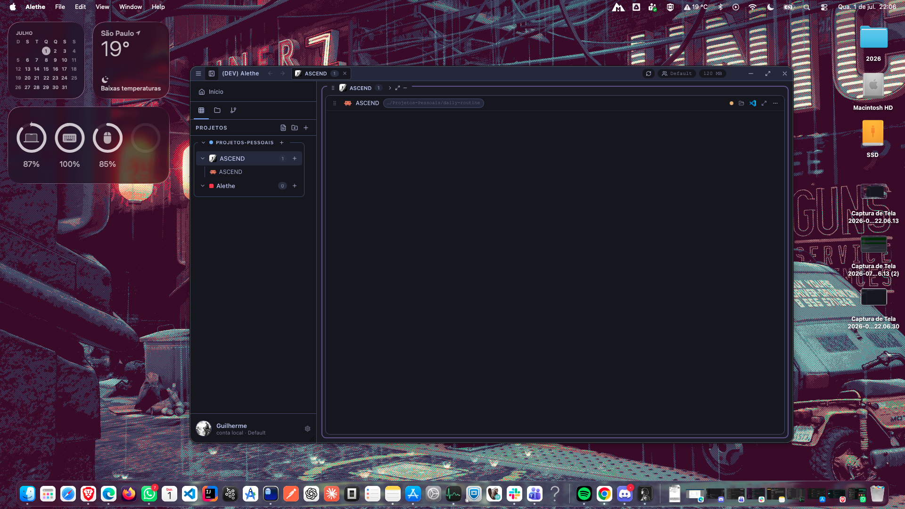
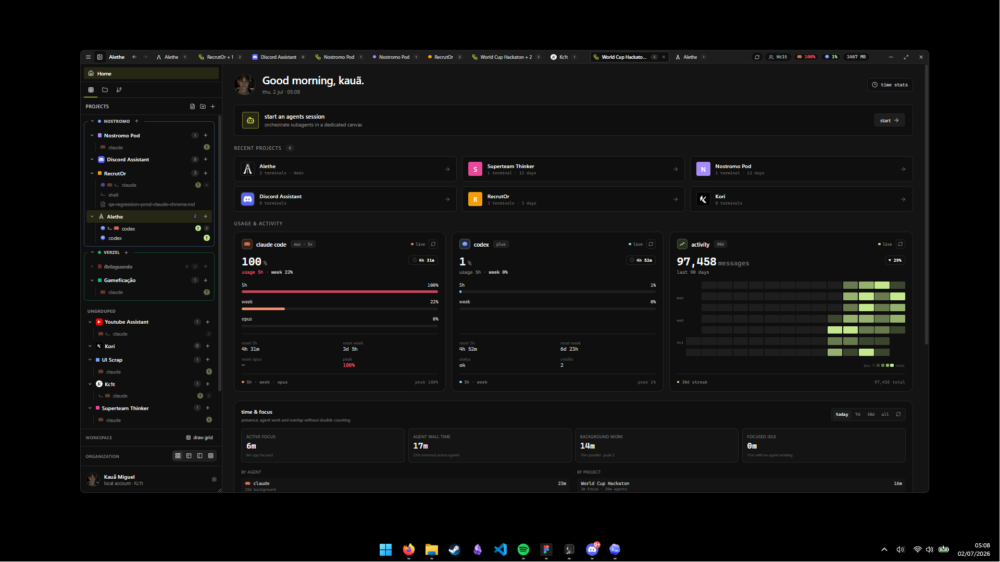
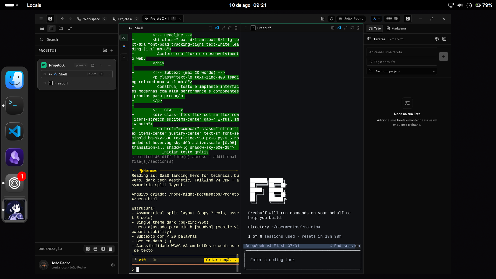
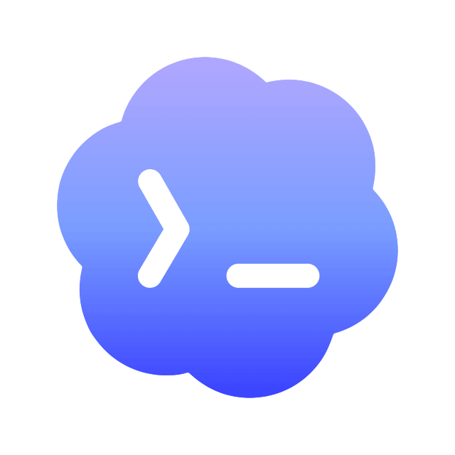
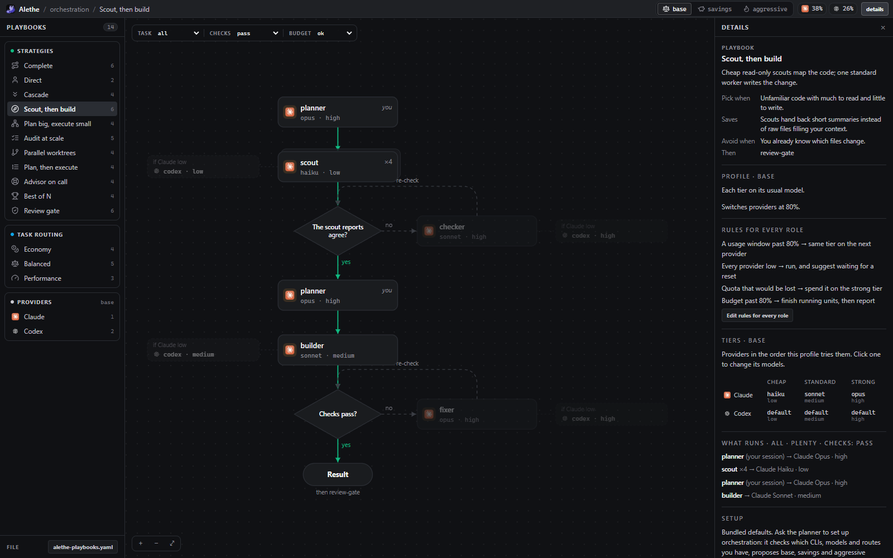
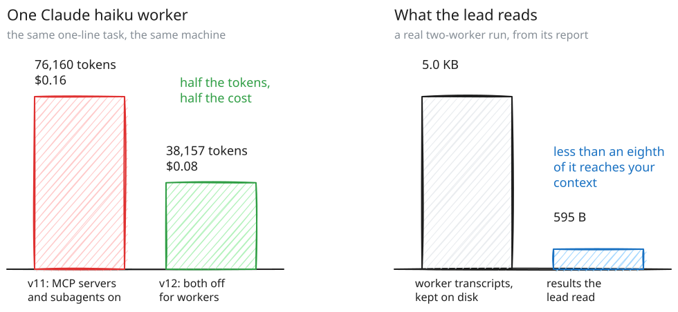

<a id="readme-top"></a>

<br />
<div align="center">
  <a href="https://github.com/Kc1t/alethe-agents">
    
  </a>

  <h1 align="center">Alethe</h1>

  <p align="center">
    <b>O workspace de código com múltiplos agentes.</b>
    <br />
    Rode Claude Code, Codex, Copilot e seus shells lado a lado, num único app desktop local-first.
    <br />
    <a href="./README.md">English</a> · <a href="./README.zh-CN.md">中文说明</a>
  </p>

  <p align="center">
    <a href="https://github.com/Kc1t/alethe-agents/actions/workflows/ci.yml"></a>
    <a href="https://github.com/Kc1t/alethe-agents/releases"></a>
    <a href="https://github.com/Kc1t/alethe-agents/blob/main/LICENSE"></a>
    <a href="https://github.com/Kc1t/alethe-agents/graphs/contributors"></a>
    <a href="https://github.com/Kc1t/alethe-agents/stargazers"></a>
    <a href="https://github.com/Kc1t/alethe-agents/issues"></a>
  </p>

  <p align="center">
    <a href="https://github.com/Kc1t/alethe-agents/releases">Download</a>
    ·
    <a href="https://github.com/Kc1t/alethe-agents/issues/new?labels=bug">Reportar bug</a>
    ·
    <a href="https://github.com/Kc1t/alethe-agents/issues/new?labels=enhancement">Pedir feature</a>
    ·
    <a href="./SECURITY.md">Segurança</a>
    ·
    <a href="./docs/PRIVACY.md">Privacidade</a>
    ·
    <a href="#contribuindo">Contribuir</a>
  </p>
</div>

> [!IMPORTANT]
> O Alethe está numa versão pública inicial. O app desktop é gratuito, open source e local-first,
> mas não totalmente offline: a verificação de atualizações e a consulta de uso dos provedores vêm
> ligadas por padrão, e os outros recursos de rede são opcionais ou disparados por uma ação sua. A
> sincronização manual via GitHub Gist já está disponível; sync ou backup hospedados pelo projeto
> podem ser oferecidos separadamente no futuro. Veja o
> [guia de privacidade e fluxo de dados](./docs/PRIVACY.md) (em inglês).

<div align="center">

https://github.com/user-attachments/assets/e5e52485-51e8-476c-acf3-4a5a5400dacf

</div>

## O que é o Alethe

Um agente num terminal é fácil. Cinco agentes em três repositórios é o trabalho de verdade, e é aí
que abas de terminal param de funcionar: sessões se perdem, os servidores MCP de cada agente ficam
diferentes, e ninguém sabe qual agente está fazendo o quê, e onde.

**O Alethe é um workspace desktop feito para isso.** Cada agente roda num PTY real dentro de um
layout de projeto persistente, mantém sua própria sessão e histórico, e continua vivo quando você
reorganiza a interface. Além disso, o Alethe gerencia o que os agentes compartilham: os CLIs, os
servidores MCP, as skills e as conversas que você passa de um para outro.

Multiplataforma (Windows, macOS, Linux), local-first, feito com Tauri, Rust, React e `xterm.js`.
"Local-first" descreve onde o workspace é salvo, não uma garantia de funcionar sem internet; veja
[`docs/PRIVACY.md`](./docs/PRIVACY.md) para os padrões de rede, credenciais e retenção de dados.

## Plataformas suportadas

<table>
  <tr>
    <th width="33.33%">macOS</th>
    <th width="33.33%">Windows</th>
    <th width="33.33%">Linux</th>
  </tr>
  <tr>
    <td align="center">
      
    </td>
    <td align="center">
      
    </td>
    <td align="center">
      
    </td>
  </tr>
  <tr>
    <td align="center">Disponível para macOS</td>
    <td align="center">Disponível para Windows</td>
    <td align="center">Disponível para Linux</td>
  </tr>
</table>

## Agentes

| | Agente | CLI | |
|:-:|---|---|---|
|  | **Claude Code** | `claude` | Retomada de sessão, cards de uso, histórico local |
|  | **Codex** | `codex` | Retomada de sessão, cards de uso |
| <picture><source media="(prefers-color-scheme: dark)" srcset="./docs/assets/agents/copilot-dark.svg"></picture> | **GitHub Copilot CLI** | `copilot` | |
| <picture><source media="(prefers-color-scheme: dark)" srcset="./docs/assets/agents/cursor-dark.svg"></picture> | **Cursor** | `cursor-agent` | Retomada de sessão |
|  | **Antigravity** | `agy` | Cards de uso |
| <picture><source media="(prefers-color-scheme: dark)" srcset="./docs/assets/agents/opencode-dark.png"></picture> | **OpenCode** | `opencode` | Retomada de sessão |
|  | **Kiro CLI** | `kiro-cli` | |
| <picture><source media="(prefers-color-scheme: dark)" srcset="./docs/assets/agents/kimi-dark.svg"></picture> | **Kimi Code** | `kimi` | |
| <picture><source media="(prefers-color-scheme: dark)" srcset="./docs/assets/agents/grok-dark.svg"></picture> | **Grok Build** | `grok` | |
| <picture><source media="(prefers-color-scheme: dark)" srcset="./docs/assets/agents/codewhale-dark.svg"></picture> | **Codewhale** | `codewhale` | |
| <picture><source media="(prefers-color-scheme: dark)" srcset="./docs/assets/agents/mimo-dark.svg"></picture> | **Mimo** | `mimo` | |
|  | **Freebuff** | `freebuff` | |
| <picture><source media="(prefers-color-scheme: dark)" srcset="./docs/assets/agents/shell-dark.svg"></picture> | **Shell** | pwsh / bash / zsh | O terminal comum, no mesmo modelo de painéis |
| <picture><source media="(prefers-color-scheme: dark)" srcset="./docs/assets/agents/wsl-dark.svg"></picture> | **WSL** | `wsl.exe` | A distro padrão, como shell comum (Windows) |

CLIs que faltam podem ser instalados, atualizados e desinstalados de dentro do Alethe. Ele verifica
se a máquina tem Node, npm, WinGet, Scoop e Chocolatey e oferece só os métodos que funcionam ali,
preferindo o instalador oficial de cada fornecedor. CLIs já instalados são encontrados no PATH, no
registro e em npm/pnpm/Volta/fnm/nvm/Bun/Cargo/Scoop/Chocolatey, e podem apontar para um caminho
personalizado. Um plugin pode adicionar o próprio agente a essa lista.

Os agentes podem, opcionalmente, passar pelo [9router](https://github.com/decolua/9router), um proxy
local que distribui o tráfego entre provedores com fallback automático. O Alethe instala e roda uma
cópia própria, com versão fixa, sem mexer nos seus pacotes npm globais. O roteamento vem desligado e
vale só para terminais abertos depois que ele é ligado.

## O que ele faz

**Rodar agentes em paralelo**

- Projetos, grupos e subgrupos organizam os repositórios; cada projeto aberto vira um container com
  seus próprios painéis.
- Um agente por painel, ou vários agentes como sub-abas no mesmo painel, cada um com seu PTY, pasta
  de trabalho e sessão.
- Layouts automático, spotlight, barra lateral e grade personalizada, editáveis direto na grade.
- Fechar um container só o esconde; o processo continua rodando.

**Manter o contexto**

- Sessões do Claude Code, Codex, Cursor e OpenCode são retomadas depois de um crash ou reinício.
- **Chats recentes** lista as conversas da pasta de trabalho de um painel e reabre qualquer uma.
- Uma conversa do Claude Code pode ser **passada para o Codex** (e de volta) por um pacote de
  contexto com dados sensíveis removidos localmente, sem copiar a conversa à mão. A remoção é feita
  no melhor esforço, então revise o pacote antes de iniciar o agente de destino.
- O histórico de saída de cada PTY é salvo, então ao reabrir você vê o que aconteceu antes.

**Gerenciar o que os agentes compartilham**

- **Aba MCP**: todos os servidores MCP configurados na máquina, agrupados por servidor e mostrando
  quais agentes os têm, lidos das configs do Claude Code, Codex, Cursor, OpenCode e Antigravity.
  Adicione, remova, copie um servidor de um agente para outro, busque no registro oficial e peça a
  cada agente para confirmar que consegue acessar um servidor. Toda gravação tem backup, é validada
  de novo e aplicada de forma atômica.
- **Aba Skills**: as skills instaladas de cada agente, com links e pastas compartilhadas resolvidos,
  para que uma skill compartilhada apareça uma vez só.
- **Graphify**: um grafo do código do projeto, servido aos agentes como servidor MCP.

**Estender com plugins**

- Recursos são carregados como **plugins**, não como código fixo. Os oficiais (Todo List, Git
  Control, Theme Pack) vêm no instalador e podem ser desligados em Preferências ▸ Plugins, aparecendo
  e sumindo sem reiniciar o app.
- Um plugin pode adicionar um painel, uma aba na barra lateral, um comando na paleta, um tema
  completo ou um novo provedor de agente. Ele declara o que precisa no manifesto, e o app recusa
  qualquer coisa que ele não pediu.
- **Catálogo de plugins**: plugins publicados por outras pessoas aparecem no Alethe com as permissões
  descritas, e os que têm pacote instalam e atualizam com um clique. O índice fixa cada pacote num
  checksum SHA-256, então o que roda é exatamente o que foi revisado. Um plugin instalado chega
  desligado e passa por uma tela de confiança antes de rodar.

**Publicando um plugin**

Um plugin é uma pasta cujo nome é igual ao `id` do seu `plugin.json`, ao lado de um bundle `main.js`
que usa o `window.alethe` (inclusive o React; nunca empacote o seu). O manifesto declara as abas,
comandos e capacidades; o código os implementa.

1. **Teste localmente.** Coloque a pasta em `<perfil>/plugins/<id>/`, ou use Preferências ▸ Plugins
   ▸ *Importar plugin*. Ele chega desligado; para ativá-lo, passa pela tela de confiança.
2. **Publique um zip.** Compacte a pasta do plugin, calcule o SHA-256 e anexe a uma release:
   `zip -r my-plugin.zip my-plugin && sha256sum my-plugin.zip`.
3. **Entre na lista.** Abra um pull request neste repositório adicionando uma entrada ao
   [`plugins.json`](plugins.json) com `id`, `name`, `downloadUrl` e, para ser instalável de dentro do
   Alethe, `package.url` e `package.sha256`. Recalcule o hash sempre que o zip mudar.
4. Depois do merge, a listagem chega a todos em até seis horas, ou na hora com *Atualizar*.

Entrar na lista é uma pessoa lendo o seu pull request, não uma auditoria: o plugin continua chegando
desligado e passando pela tela de confiança. `docs/examples/notes-plugin/` é um plugin funcional em
JavaScript puro, sem etapa de build; o [guia de plugins](docs/PLUGINS.md) tem o contrato completo.

Para um plugin com toolchain de verdade, o [Jev](https://github.com/Kc1t/alethe-jev) é o plugin
externo de referência: repositório próprio, TypeScript, React e CSS Modules compilados pelo Vite num
único script, publicado como zip com checksum e instalado pelo catálogo.
O [Agent Voice](https://github.com/Kc1t/alethe-agent-voice) é construído da mesma forma na API de
plugins 3, acompanhando a saída do terminal e usando os ícones e dropdowns de agentes do próprio app.

**Ficar no controle**

- Uso de RAM na barra de título; desative um terminal ou suspenda um grupo inteiro para liberar
  memória.
- Painel Git por projeto (status, stage, commit, branches, diffs num painel), mais worktrees para
  tarefas em paralelo.
- **Revisão de Pull Request**: o painel de merge encontra o PR aberto no GitHub para o worktree de
  um agente usando o CLI `gh` local, mostra os dados dele e pode iniciar uma revisão por IA no mesmo
  worktree isolado, só de leitura, sem commits, pushes, merges ou comentários no GitHub. O squash
  merge continua sendo uma ação humana explícita, bloqueada quando o SHA do head mudou, o PR é
  rascunho ou o GitHub aponta conflitos. Nenhum token do GitHub é salvo; a autenticação fica com o
  `gh`.
- Painéis de conteúdo ao lado dos terminais: explorador de arquivos, Markdown, diffs, imagens,
  vídeo, navegador embutido.
- Tarefas por projeto com timer Pomodoro, perfis isolados, exportação e importação de backup local,
  temas de interface e de terminal, idiomas EN, pt-BR e zh-CN.
- **Quadro de orquestração**: um agente líder delega partes do trabalho para workers Claude e Codex
  que o Alethe roda em paralelo, cada um opcionalmente no próprio worktree git, mostrando status,
  custo, tokens e diff no seu card, e podendo pedir sua permissão antes de sair do sandbox. Vem
  desligado.
- **Sync na nuvem** das suas preferências via login no GitHub, opcional. Comandos de voz e ditado
  local vêm do plugin opcional **Jev**, e agentes que falam as próprias respostas vêm do plugin
  opcional **Agent Voice**.
- **Controle remoto**: uma página web autenticada na rede local, pareada por QR code, para
  acompanhar e responder os agentes pelo celular. Vem desligado e usa HTTP/WebSocket sem criptografia
  na rede local, então só ligue numa rede confiável. Perfis limpos são somente leitura; responder aos
  agentes exige uma permissão de entrada separada, e a entrada em shell tem mais uma permissão própria.
- Spotify "tocando agora", usando as credenciais do seu próprio app do Spotify em **Preferências ▸
  Spotify**, com `http://127.0.0.1:8888/callback` como URI de redirecionamento. As versões atuais
  guardam essas credenciais em arquivos locais do perfil; veja o guia de privacidade antes de
  exportar ou compartilhar dados de perfil.

## Orquestração

O Alethe traz a [`alethe`](https://github.com/Kc1t/alethe-orchestrate-skill), sua skill oficial de
orquestração. O agente com quem você conversa vira o líder: escolhe um playbook, escreve briefs
delimitados e os entrega a workers mais baratos (Claude Code, Codex, Antigravity ou Kimi), lendo de
volta apenas os resultados. Instale pela janela de Skills, para todos os projetos ou dentro de um
repositório, e ajuste em **Preferências ▸ Orquestração**.

<p align="center">
  <picture>
    <source media="(prefers-color-scheme: dark)" srcset="./docs/assets/orchestration/how-it-works-dark.svg">
    
  </picture>
</p>

Toda orquestração segue um playbook. **Preferências ▸ Playbooks** mostra cada um como um canvas de
blocos: arraste workers, verificações e condições da paleta, conecte as portas e solte uma condição
sobre um worker para trocar o modelo dele. As condições cobrem a tarefa, a cota (um provedor com
pouca ou sobrando, uma janela acima de um percentual) e o custo (orçamento baixo, preço do modelo por
milhão de tokens, gasto até o momento). Escolha uma tarefa, o resultado da verificação, o orçamento e
o gasto para acender o caminho que seria executado, alterne entre os perfis base, economia e
agressivo, e acompanhe a cota do Claude e do Codex ao vivo. Salvar grava o `alethe-playbooks.yaml`,
arquivo com o qual a skill planeja.

<p align="center">
  
</p>

Os workers devolvem resultados, não transcrições, então o contexto do líder fica pequeno e o gasto é
o que cada CLI reportou, nunca uma estimativa.

<p align="center">
  <picture>
    <source media="(prefers-color-scheme: dark)" srcset="./docs/assets/orchestration/savings-dark.svg">
    
  </picture>
</p>

**A skill também funciona sem o Alethe.** Ela é uma skill de agente independente, com repositório
próprio, [Kc1t/alethe-orchestrate-skill](https://github.com/Kc1t/alethe-orchestrate-skill), e roda
no Claude Code, no Codex e em qualquer agente que leia `SKILL.md`:

```sh
npx skills add Kc1t/alethe-orchestrate-skill
```

O [README](https://github.com/Kc1t/alethe-orchestrate-skill#readme) dela cobre os plugins do Claude
Code e do Codex, os comandos `/alethe`, os playbooks e o relatório de custo. Mudanças na skill vão
primeiro para esse repositório; `npm run skill:sync` as traz para o Alethe.

## Conceitos principais

| | |
|---|---|
| **Grupo** | Um conjunto de projetos que abre, recolhe e suspende junto. |
| **Projeto** | Um contexto de trabalho salvo: terminais, layout, cor, estado local. |
| **Container** | A moldura visível de um projeto aberto. Fechar não encerra nada. |
| **Painel** | Uma visão de terminal dentro de um container. |
| **Sub-aba** | Uma sessão separada de agente ou shell dentro do mesmo painel. |
| **PTY** | O processo real no backend, vivo independente da interface. |

## Filosofia do produto

Um núcleo focado com recursos opcionais, mais perto do Obsidian do que de uma IDE maximalista.
Recursos não essenciais ficam atrás de feature flags ou configurações opcionais, e uma instalação
limpa continua sendo uma experiência completa. Coerência acima de volume.

## Instalação

Use os instaladores publicados em [Releases](https://github.com/Kc1t/alethe-agents/releases).

> [!WARNING]
> As versões para Windows **ainda não são assinadas**, então o Defender pode marcar o `alethe.exe`
> como `Trojan:Win32/Bearfoos.A!ml` e colocá-lo em quarentena. O sufixo `!ml` indica uma heurística
> de machine learning, não uma assinatura de vírus conhecida, e o comportamento de um multiplexador
> de terminal (criar processos filhos e PTYs) pode gerar falsos positivos. Confira se o download veio
> da página oficial de Releases; não ignore o aviso para um arquivo de outra origem.

Para recuperar: **Segurança do Windows → Proteção contra vírus e ameaças → Histórico de proteção →
Ações → Restaurar**, e adicione uma exclusão para `%LOCALAPPDATA%\Alethe` (e `src-tauri/target`, se
compilar do código-fonte). No macOS as versões também ainda não são notarizadas: clique com o botão
direito no app e escolha **Abrir** para passar pelo Gatekeeper. Assinatura e notarização estão no
[roadmap](#roadmap).

## Rodar a partir do código-fonte

```sh
git clone https://github.com/Kc1t/alethe-agents.git
cd alethe-agents
npm install
npm run app
```

Requisitos: Node.js 18+, Rust stable, Visual Studio Build Tools no Windows, e as dependências de
sistema do Tauri no Linux:

```sh
sudo apt install -y libwebkit2gtk-4.1-dev libappindicator3-dev librsvg2-dev patchelf
```

```sh
npm run app          # app desktop com hot reload
npm run dev          # só o frontend
npm run build        # typecheck + build do frontend
npm run tauri build  # instaladores → src-tauri/target/release/bundle/
```

## Comando no terminal

Instale o comando `alethe` em **Configurações ▸ Integrações ▸ Comando de terminal**:

```bash
alethe                # abre a pasta atual como projeto
alethe ~/algum/projeto # abre a pasta indicada
```

Se a pasta já for um projeto, ele é trazido para o workspace em vez de duplicado. Se o Alethe já
estiver aberto, a janela existente ganha o foco. O comando fica em `~/.local/bin/alethe`
(macOS/Linux) ou `%LOCALAPPDATA%\Alethe\bin\alethe.cmd` (Windows); reinstale depois de mover o app.

## Roadmap

- [x] Workspace multiagente com projetos, grupos, containers e sub-abas.
- [x] PTYs reais com spawn, attach, resize, histórico de saída e retomada de sessão.
- [x] Instalar, atualizar e desinstalar agentes; gerenciar MCP e skills.
- [x] Versões para Windows, Linux e macOS.
- [ ] Assinatura das versões para Windows e notarização no macOS.
- [ ] Validação mais ampla em máquinas reais com Linux e macOS.
- [ ] Sync e backup na nuvem hospedados pelo projeto (o sync manual via GitHub Gist já existe).

## Contribuindo

Contribuições são bem-vindas. Leia o [`CONTRIBUTING.md`](CONTRIBUTING.md) (em inglês) para setup,
estrutura do projeto e regras da casa. Os jeitos mais fáceis de ajudar:

- Pegue uma issue marcada como [`good first issue`](https://github.com/Kc1t/alethe-agents/issues?q=is%3Aissue+is%3Aopen+label%3A%22good+first+issue%22) ou [`help wanted`](https://github.com/Kc1t/alethe-agents/issues?q=is%3Aissue+is%3Aopen+label%3A%22help+wanted%22) e comente para reservá-la.
- Reporte um bug com passos claros para reproduzir, ou peça uma feature explicando o fluxo que ela
  melhora.
- Melhore documentação, screenshots e testes em outras plataformas; Linux e macOS são os menos
  testados.

Para mudanças maiores, abra uma issue antes para discutir a direção.

A lista de contribuidores, os vídeos e os projetos feitos com o Alethe ficam no
[README em inglês](./README.md#contributors), que é atualizado automaticamente.

## Licença

O código-fonte é distribuído sob **AGPL-3.0-or-later**. Modificações e obras derivadas que forem
distribuídas, ou disponibilizadas a usuários pela rede, precisam fornecer o código-fonte
correspondente sob a mesma licença. Veja [`LICENSE`](LICENSE) e [`NOTICE`](NOTICE).

Serviços oficiais hospedados, como sync, backup, cobrança ou recursos na nuvem, podem ser
proprietários e oferecidos separadamente. A licença do código não dá direitos sobre o nome
**Alethe**, o logo, o ícone do app ou a marca oficial. Builds modificadas precisam ter marca
própria, e o uso comercial da marca Alethe exige permissão prévia por escrito de Kauã Miguel. Veja
[`TRADEMARK.md`](TRADEMARK.md).

## Comunidade

- Relatos de segurança: [`SECURITY.md`](SECURITY.md)
- Privacidade e fluxo de dados: [`docs/PRIVACY.md`](docs/PRIVACY.md)
- Mantenedor: [Kc1t](https://github.com/Kc1t)
- Projeto: <https://github.com/Kc1t/alethe-agents>
- Bugs e pedidos de feature: <https://github.com/Kc1t/alethe-agents/issues>
